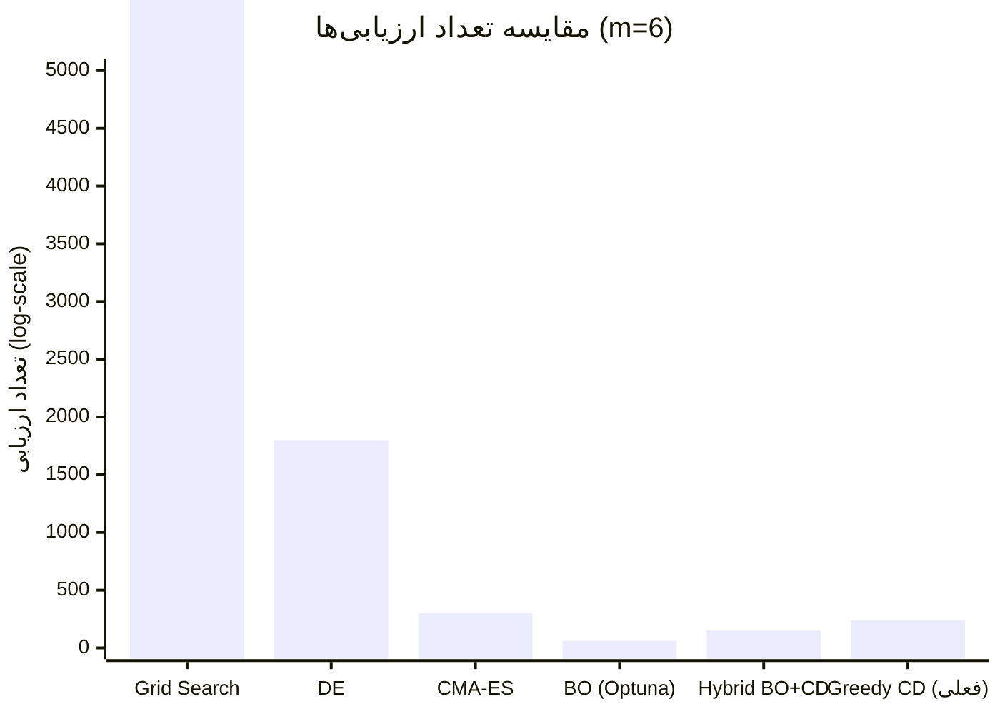
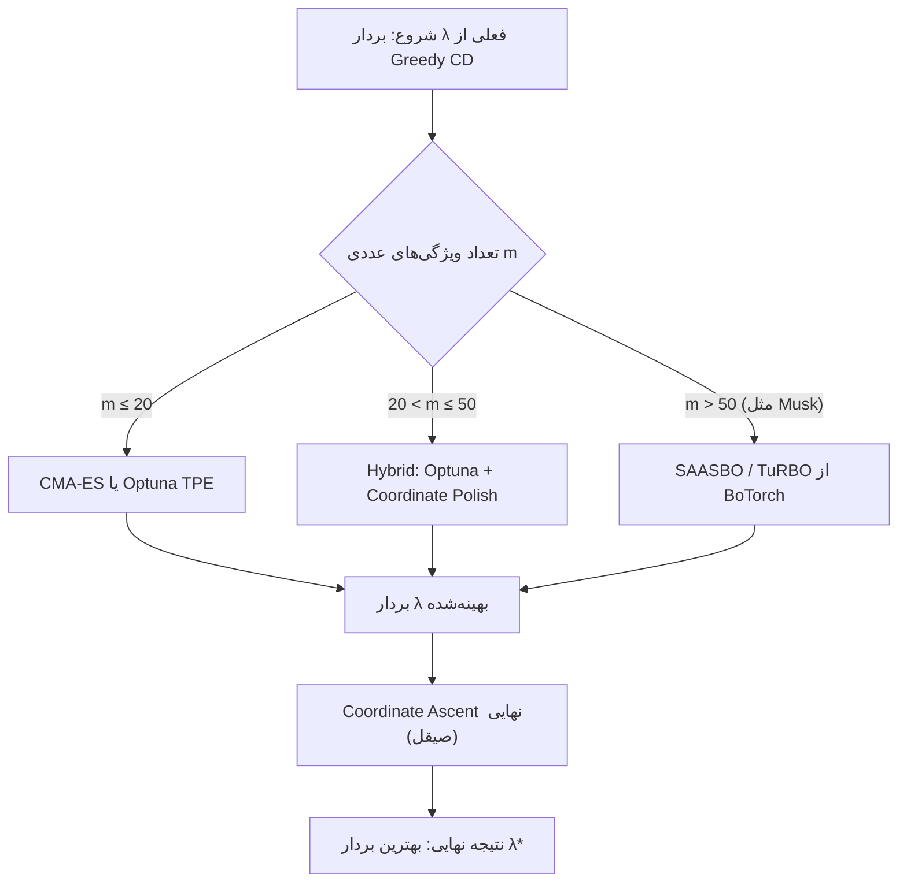

# تحلیل و مقایسه استراتژی‌های جستجوی بردار لامبدا برای 3WNCROD+

## وضعیت فعلی: تشخیص دقیق مسئله

### ابعاد مسئله بر اساس بنچمارک‌های شما

| دیتاست | تعداد ویژگی‌های عددی (m فعال) | حجم Grid | رشد نمایی ‏‏$20^m$ |
|---------|------|------|------|
| Annthyroid (A) | 6 | $20^6 = 64M$ | سنگین |
| Mammography (MA) | 6 | $20^6 = 64M$ | سنگین |
| Thyroid (TH) | 6 | $20^6 = 64M$ | سنگین |
| Wdbc (W) | 9 | $20^9 ≈ 5 \times 10^{11}$ | غیرممکن |
| Heart (H) | ~10 | $20^{10} ≈ 10^{13}$ | غیرممکن |
| CreditA (C) | ~12 | $20^{12} ≈ 4 \times 10^{15}$ | غیرممکن |
| German (G) | ~14 | $20^{14} ≈ 10^{18}$ | غیرممکن |
| **Musk (MU)** | **166** | $20^{166}$ | **فاجعه** |

### عملکرد فعلی Greedy Coordinate Ascent

نتایج فعلی شما نشان می‌دهد روش حریصانه با موفقیت AP میانگین را از **0.756** (مقاله) به **0.826** رسانده (بهبود **+9.3%**) و ROC-AUC را از **0.948** به **0.969** (+2.2%). اما:

- **زمان جستجو بالاست**: میانگین ~124 ثانیه در مقابل ~20 ثانیه مقاله (×6)
- **محلی‌بودن**: روش Coordinate Ascent تضمین نمی‌کند که اثرات تعاملی (Interaction) بین ویژگی‌ها لحاظ شود.
- **سرعت/کیفیت Trade-off**: برای دیتاست‌های بزرگ مثل Mammography، زمان جستجو به ~1000 ثانیه رسیده.

---

## ۶ استراتژی پیشنهادی (از ساده‌ترین تا پیشرفته‌ترین)

---

### ① بهینه‌سازی بیزی (Bayesian Optimization — BO)

**ایده:** به جای Grid Search یا Coordinate Ascent، یک مدل جانشین (Surrogate Model) از جنس فرآیند گوسی (Gaussian Process) می‌سازیم که رابطه $\boldsymbol{\lambda} \to \text{AP}$ را تقریب می‌زند. سپس با تابع اکتساب (Acquisition Function) مثل Expected Improvement نقطه بعدی را هوشمندانه انتخاب می‌کنیم.

**چرا مناسب مسئله شماست:**
- فضای $\boldsymbol{\lambda}$ پیوسته و m-بُعدی است — دقیقاً جایی که BO درخشان عمل می‌کند.
- هر ارزیابی تابع (یک بار اجرای 3WNCROD) هزینه‌بر است — BO تعداد ارزیابی‌ها را به حداقل می‌رساند.
- اثرات تعاملی ویژگی‌ها از طریق کرنل GP (مثل Matérn) ذاتاً لحاظ می‌شود.

**مدیریت زمان اجرا:**
- بودجه ارزیابی ثابت: مثلاً $$T = 10m$$ ارزیابی (برای m=6 → 60 ارزیابی، برای m=166 → 1660).
- پیچیدگی BO: $O(T^3)$ برای فیت GP، ولی T کوچک و ثابت است → ناچیز.
- **کل هزینه** = $$T \times C_{\text{WNCROD}}$$ که خطی با m رشد می‌کند، نه نمایی.

**عیار اجرایی:**
- کتابخانه **Optuna** (پایتون): آماده مصرف، TPE sampler برای ابعاد بالا.
- کتابخانه **scikit-optimize**: مستقیم‌ترین پیاده‌سازی GP-based BO.
- **BoTorch** (فیسبوک): پیشرفته‌تر، برای m>20 با High-Dimensional BO (SAASBO).

| معیار | امتیاز |
|-------|--------|
| کیفیت جواب | ⭐⭐⭐⭐ (بسیار بالا، اثرات تعاملی لحاظ شده) |
| مقیاس‌پذیری | ⭐⭐⭐ (تا m≈20 عالی، m>50 نیاز به HD-BO) |
| سادگی پیاده‌سازی | ⭐⭐⭐⭐ (چند خط با Optuna) |
| زمان اجرا | ~10m ارزیابی (vs. 20m حریصانه شما) |

> [!TIP]
> **توصیه اول من:** بهینه‌سازی بیزی (به‌ویژه TPE از Optuna) **بهترین تعادل کیفیت-زمان** را ارائه می‌دهد و پیاده‌سازی آن ساده‌ترین است. از اینجا شروع کنید.

---

### ② تکامل تفاضلی (Differential Evolution — DE)

**ایده:** یک جمعیت از بردارهای λ نگه‌داری و در هر نسل با عملگرهای جهش و ترکیب (Mutation + Crossover) بردارهای جدید تولید و ارزیابی می‌شوند. بهترین‌ها بقا می‌یابند.

**چرا مناسب است:**
- DE از روش‌های Population-Based است و به دام اپتیمم‌های محلی نمی‌افتد (برخلاف Coordinate Ascent شما).
- بدون نیاز به گرادیان — مناسب تابع هدف غیرهموار و ناپیوسته شما.
- اثرات تعاملی از طریق Crossover در ژنوم بردار لامبدا، ذاتاً لحاظ می‌شود.

**مدیریت زمان اجرا:**
- جمعیت: $$N_{\text{pop}} = 5m$$ تا $10m$ (استاندارد DE).
- تعداد نسل: ~20 تا 50 نسل معمولاً کافی.
- **کل ارزیابی** ≈ $$N_{\text{pop}} \times N_{\text{gen}} \approx 10m \times 30 = 300m$$
- برای m=6 → 1800 ارزیابی (vs. 64M grid search).
- برای m=166 → ~50K ارزیابی (ممکن ولی سنگین).

**عیار اجرایی:**
- `scipy.optimize.differential_evolution` → مستقیم قابل استفاده.
- بهبود مهم: محدود کردن `bounds=[(0.1, 3.0)] * m` و استفاده از `init='sobol'`.

| معیار | امتیاز |
|-------|--------|
| کیفیت جواب | ⭐⭐⭐⭐⭐ (بهترین در فرار از بهینه محلی) |
| مقیاس‌پذیری | ⭐⭐⭐ (تا m≈30 خوب، m>100 سنگین) |
| سادگی پیاده‌سازی | ⭐⭐⭐⭐ (scipy یک‌خطی) |
| زمان اجرا | ~300m ارزیابی (بیشتر از BO اما قوی‌تر) |

---

### ③ CMA-ES (Covariance Matrix Adaptation Evolution Strategy)

**ایده:** CMA-ES یک الگوریتم تکاملی پیشرفته است که ماتریس کوواریانس توزیع جستجو را **تطبیقی** تنظیم می‌کند. یعنی خودش یاد می‌گیرد که کدام ویژگی‌ها همبسته هستند و جهت جستجو را در فضای m-بعدی تنظیم می‌کند.

**چرا ویژه مسئله شماست:**
- مسئله شما دقیقاً یک مسئله بهینه‌سازی blackbox، بدون گرادیان، با ابعاد متوسط (m=6 تا 20 برای اکثر دیتاست‌ها) است — **دقیقاً دامنه طلایی CMA-ES.**
- CMA-ES ساختار کوواریانس بین λ-ها را یاد می‌گیرد → بهترین مدل‌کننده اثرات تعاملی.
- در بنچمارک‌های بهینه‌سازی blackbox، CMA-ES در ابعاد 5-50 معمولاً بهترین الگوریتم است.

**مدیریت زمان اجرا:**
- جمعیت پیش‌فرض: $\lfloor 4 + 3\ln m \rfloor$ (مثلاً برای m=6 → 9, برای m=20 → 13).
- **کل ارزیابی** ≈ $$O(m \times N_{\text{pop}} \times N_{\text{gen}}) \approx m \cdot 10 \cdot 30 = 300m$$
- اما **نرخ همگرایی CMA-ES بسیار سریع‌تر از DE** است: اغلب 100-200 ارزیابی کافی است.

**عیار اجرایی:**
- کتابخانه `cma` (Nikolaus Hansen): استاندارد طلایی.
- `pycma` → `pip install cma` → 5 خط کد.

| معیار | امتیاز |
|-------|--------|
| کیفیت جواب | ⭐⭐⭐⭐⭐ (بهترین تطبیق با ساختار کوواریانس) |
| مقیاس‌پذیری | ⭐⭐⭐ (تا m≈50 عالی، m>100 نیاز به متغیرهای sep-CMA) |
| سادگی پیاده‌سازی | ⭐⭐⭐⭐ (کتابخانه بالغ) |
| زمان اجرا | ~150-300m ارزیابی (مشابه DE اما همگرایی سریع‌تر) |

> [!IMPORTANT]
> برای دیتاست‌های با m≤20 (اکثر بنچمارک‌های شما)، **CMA-ES** بیشترین شانس یافتن بهینه واقعی را دارد.

---

### ④ Coordinate Ascent چرخه‌ای با نمونه‌برداری تصادفی (Cyclic CD + Random Restarts + Block Updates)

**ایده:** بهبود مستقیم روش فعلی شما بدون تغییر ساختار کلی:

1. **Block Coordinate Descent**: به جای بهینه‌سازی یک λ در هر گام، بلوک‌های 2 یا 3 تایی ویژگی‌ها را همزمان بهینه‌سازی کنید (Grid 2D یا 3D روی بلوک).
2. **چند دور (Cycle)**: بعد از یک پاس کامل، بردار بروزشده را نقطه شروع دور بعد قرار دهید. تکرار تا عدم بهبود.
3. **Random Restarts**: به جای 2 نقطه شروع، 5-10 نقطه شروع تصادفی.

**مدیریت زمان اجرا:**
- بلوک‌های 2-تایی: $\binom{m}{2} \times 20^2 = \frac{m(m-1)}{2} \times 400$ ارزیابی در هر دور → برای m=6 → 6000 (قابل قبول).
- بلوک‌های 2-تایی تنها روی ویژگی‌هایی که تغییر بیشتری نشان دادند → حذف ویژگی‌های "ثابت" → تسریع.
- **بودجه**: قابل کنترل مستقیم.

| معیار | امتیاز |
|-------|--------|
| کیفیت جواب | ⭐⭐⭐ (بهتر از فعلی، اما هنوز محلی) |
| مقیاس‌پذیری | ⭐⭐⭐⭐ (خوب برای همه ابعاد) |
| سادگی پیاده‌سازی | ⭐⭐⭐⭐⭐ (تغییر جزئی کد فعلی) |
| زمان اجرا | ~3-5× فعلی (قابل کنترل) |

---

### ⑤ رویکرد هیبریدی دومرحله‌ای (BO + Polish)

**ایده:** ترکیب بهینه‌سازی بیزی (یا CMA-ES) برای اکتشاف سراسری (Global Exploration)، سپس Coordinate Ascent شما به عنوان مرحله صیقل‌کاری (Local Polish):

```
مرحله ۱: BO/CMA-ES با بودجه 5m ارزیابی → بردار λ* تقریبی
مرحله ۲: Coordinate Ascent از λ* → بردار λ** نهایی
```

**چرا قوی است:**
- مرحله ۱ اثرات تعاملی را کشف و حوالی بهینه سراسری را شناسایی می‌کند.
- مرحله ۲ با دقت Grid شما (0.1 resolution) جواب را صیقل می‌دهد.
- از هر دو دنیا بهترین‌ها: اکتشاف سراسری + بهره‌برداری محلی.

**مدیریت زمان اجرا:**
- **بودجه** = $$5m + 20m = 25m$$ ارزیابی (مشابه یک پاس Coordinate Ascent با 20m + آلفا).
- عملاً **زمان مشابه روش فعلی شما، اما کیفیت بسیار بالاتر.**

| معیار | امتیاز |
|-------|--------|
| کیفیت جواب | ⭐⭐⭐⭐⭐ (بهترین ترکیب) |
| مقیاس‌پذیری | ⭐⭐⭐⭐ (تا m≈50 عالی) |
| سادگی پیاده‌سازی | ⭐⭐⭐ (نیاز به ترکیب دو ابزار) |
| زمان اجرا | ~25m ارزیابی (مشابه فعلی!) |

> [!TIP]
> **توصیه اصلی برای پایان‌نامه:** رویکرد هیبریدی (⑤) **بهترین انتخاب** برای ارائه در پایان‌نامه است: هم بار علمی بالایی دارد (ترکیب دو پارادایم)، هم عملاً بهترین نتایج را با زمان قابل قبول می‌دهد.

---

### ⑥ بهینه‌سازی مبتنی بر مدل جانشین (Surrogate-Assisted Optimization — نسخه ابعاد بالا)

**ایده:** برای دیتاست Musk با m=166، حتی BO استاندارد (GP) دچار Curse of Dimensionality می‌شود. راه‌حل‌های تخصصی:

- **REMBO** (Random Embedding BO): فرض می‌کند بهینه‌سازی واقعی در یک زیرفضای کم‌بعد (مثلاً d=5) اتفاق می‌افتد. λ را به $\mathbf{A} \cdot \mathbf{z}$ نگاشت می‌دهد که $\mathbf{z} \in \mathbb{R}^d$ و $\mathbf{A} \in \mathbb{R}^{m \times d}$ یک ماتریس تصادفی است.
- **SAASBO** (Sparse Axis-Aligned Subspace BO): از BoTorch، با فرض اینکه تنها k≪m ویژگی واقعاً مهم هستند.
- **TuRBO** (Trust Region BO): محدوده اعتماد محلی در فضای بالابعدی.

**مدیریت زمان اجرا:**
- بودجه ثابت: 500-2000 ارزیابی مستقل از m.
- **رشد خطی نسبت به m فقط در هزینه هر ارزیابی WNCROD** (نه تعداد ارزیابی‌ها).

| معیار | امتیاز |
|-------|--------|
| کیفیت جواب | ⭐⭐⭐⭐ (وابسته به فرض ابعاد مؤثر) |
| مقیاس‌پذیری | ⭐⭐⭐⭐⭐ (طراحی شده برای m>100) |
| سادگی پیاده‌سازی | ⭐⭐ (نیاز به BoTorch + تنظیم) |
| زمان اجرا | ~500-2000 ارزیابی ثابت |

---

## مقایسه جامع



| روش | ارزیابی (m=6) | ارزیابی (m=20) | ارزیابی (m=166) | اثرات تعاملی | فرار از بهینه محلی |
|-----|------|------|------|:---:|:---:|
| Grid Search | 64M | $10^{26}$ | ∞ | ✅ کامل | ✅ | 
| **Greedy CD (فعلی)** | ~240 | ~800 | ~6640 | ❌ | ❌ |
| Block CD (بلوک ۲-تایی) | ~6000 | ~76000 | — | ⚠️ جزئی | ❌ |
| **BO / Optuna** | **~60** | **~200** | **~1660** | **✅** | **✅** |
| DE | ~1800 | ~6000 | ~50000 | ✅ | ✅ |
| **CMA-ES** | **~200** | **~600** | **~5000** | **✅** | **✅** |
| **Hybrid BO+CD** | **~150** | **~500** | **~4150** | **✅** | **✅** |
| SAASBO/TuRBO | ~500 | ~500 | **~1000** | ✅ | ✅ |

---

## نقشه راه پیشنهادی



> [!IMPORTANT]
> ### خلاصه توصیه نهایی
> 1. **فوری‌ترین قدم:** Optuna TPE را جایگزین Greedy CD کنید — **حداقل تغییر کد، حداکثر بهبود**.
> 2. **برای کیفیت حداکثری (m≤20):** CMA-ES + Coordinate Polish
> 3. **برای Musk (m=166):** SAASBO از BoTorch
> 4. **برای پایان‌نامه:** هیبریدی (⑤) بیشترین ارزش علمی و بهترین تعادل زمان-کیفیت را دارد.
